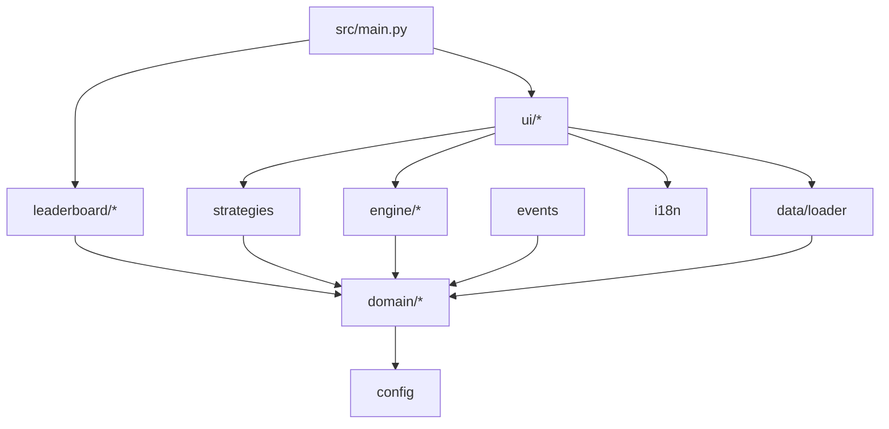

# Architecture

Module boundaries, types, configuration, and persistence contracts.

## Layout

The package lives under `src/riabita/`. Streamlit runs `src/main.py`, which puts
`src/` on `sys.path`, so modules import as `riabita.<module>`.

```
src/
├── main.py                      Streamlit entry point; composition only
└── riabita/
    ├── __init__.py
    ├── config.py                Constants, RULES_VERSION, environment settings
    ├── i18n.py                  Translation catalog and lookup
    ├── domain/
    │   ├── models.py            Frozen dataclasses shared by every layer
    │   └── validation.py        Pure allocation and dimension validation
    ├── engine/
    │   ├── simulator.py         run_simulation, the 8-step pipeline
    │   └── metrics.py           RIz, risk, Sharpe, profile classification
    ├── events.py                Event catalog and draw
    ├── strategies.py            AI and random benchmark allocations
    ├── data/
    │   ├── loader.py            GeoJSON loading, validation, demo fallback
    │   └── demo_districts.geojson
    ├── leaderboard/
    │   ├── models.py            SQLAlchemy ORM mapping
    │   ├── repository.py        Repository protocol and implementations
    │   └── service.py           Submission and query orchestration
    └── ui/
        ├── state.py             Session state keys and round lifecycle
        ├── charts.py            Plotly figure builders
        └── views.py             Streamlit render functions
```

Tests live in `tests/`, mirroring module names. Add `pyproject.toml` with
`[tool.pytest.ini_options]` setting `pythonpath = ["src"]` so tests import the
package without installation.

## Dependency direction

Dependencies point inward only. A module never imports from a layer above it.



Enforced rules:

- `domain/` and `engine/` import only the standard library, `numpy`, and `config`.
  They must not import Streamlit, GeoPandas, Plotly, or SQLAlchemy (REQ-038).
- `data/loader.py` is the only module that touches the filesystem. It parses
  GeoJSON with the standard library and imports GeoPandas only to reproject a
  non-EPSG:4326 file, so the optional `geo` extra stays optional.
- `leaderboard/repository.py` is the only module that issues queries (REQ-068).
- `ui/` is the only module that calls Streamlit.
- `main.py` wires modules together and contains no game logic.

A test that imports `riabita.engine.simulator` must pass with Streamlit, GeoPandas,
and a database all absent. Treat a violation of that as a build failure.

## Core types

Define these in `domain/models.py` as frozen dataclasses with type annotations
(REQ-082). Frozen types prevent the accidental mutation forbidden by REQ-039.

| Type | Fields |
|---|---|
| `Dimensions` | `mobility: float`, `culture: float`, `tourism: float`, `socio: float` |
| `Allocation` | `mobility: int`, `culture: int`, `tourism: int`, `socio: int`; represents one turn or a cumulative allocation |
| `District` | `district_id: str`, `name: str`, `baseline: Dimensions`, `geometry: object \| None`, `is_demo: bool` |
| `Event` | `event_id: str`, `name_key: str`, `description_key: str`, `impact: Dimensions` |
| `Modifier` | `modifier_id: str`, `points: float`, `reason_key: str`, `detail: dict[str, float]` |
| `SimulationResult` | see below |
| `LeaderboardEntry` | see the schema section |

`SimulationResult` also exposes `riz_change_pct`, the percentage change against
the starting score (REQ-059).

`SimulationResult` fields:

| Field | Meaning |
|---|---|
| `district_id: str` | District that was played |
| `allocation: Allocation` | Cumulative validated allocation through the latest turn |
| `initial: Dimensions` | Original district baseline values |
| `final: Dimensions` | Clamped values after the latest turn and event |
| `event: Event \| None` | Event drawn for the latest turn |
| `modifiers: tuple[Modifier, ...]` | Every modifier, including zero-point ones |
| `riz_initial: float`, `riz_final: float` | Scores |
| `urban_yield: float`, `risk: float`, `sharpe: float` | Metrics |
| `profile_id: str` | One of `stagnant`, `vulnerable`, `resilient`, `transitional` |
| `rules_version: str` | `config.RULES_VERSION` |

Give `Dimensions` `as_array()` and `from_array()` helpers so the engine works in
`(M, C, T, S)` order without index literals scattered through the code. Zero-point
modifiers are retained so the UI can explain what did *not* trigger.

## Engine contract

```python
def run_simulation(
    district: District,
    allocation: Allocation,
    event: Event | None = None,
) -> SimulationResult: ...

def run_turn(
    district: District,
    current: Dimensions,
    cumulative_allocation: Allocation,
    turn_allocation: Allocation,
    event: Event | None = None,
) -> SimulationResult: ...
```

The engine does not draw the event. The caller draws it and passes it in, which keeps
the engine pure and makes the shared-event requirement (REQ-053) explicit at the call
site. Raise a `ValidationError` carrying the failed identifiers from
[simulation-rules.md](./simulation-rules.md) when validation fails.

## Round orchestration

`ui/state.py` owns the progressive round lifecycle and guarantees the fairness rules:

1. Validate that the player's non-empty turn allocation fits the remaining budget.
2. Build one generator for the turn.
3. Build AI and random allocations for the same number of credits from their current
   dimensions, before drawing the event (REQ-054).
4. Draw one event shared by all three strategies.
5. Run `run_turn` three times from each strategy's prior dimensions and cumulative
   allocation.
6. Store the cumulative results and immutable turn history in session state.
7. Enable leaderboard submission only when the cumulative player allocation totals
   `100`.

Only step 5 produces scores, which is what makes REQ-064 enforceable: the leaderboard
service accepts a cumulative `SimulationResult` object, never loose numbers from the
view.

## Configuration

`config.py` holds all tunable constants (REQ-080): the impact matrix, weights,
thresholds, bonus and penalty values, budget total, and `RULES_VERSION`. No other
module defines a game constant as a literal.

Runtime settings resolve from environment variables, falling back to Streamlit
secrets. Never commit values or log them (REQ-069).

| Variable | Purpose | Default |
|---|---|---|
| `RIABITA_DATABASE_URL` | SQLAlchemy URL for SQLite or PostgreSQL | project-local `.data/riabita.sqlite3` |
| `RIABITA_DISTRICTS_PATH` | Official GeoJSON path | unset; demo data used |
| `RIABITA_DEFAULT_LANGUAGE` | `it`, `en`, or `fr` | `it` |
| `RIABITA_LEADERBOARD_LIMIT` | Rows displayed | `10` |

Expose a single `get_settings()` returning a frozen settings object. When
`RIABITA_DATABASE_URL` is unset, use the project-local SQLite database and enable
the leaderboard. A configured SQLite or PostgreSQL URL always takes precedence.
If the selected database is unreachable, results still render (REQ-071).

Add `.env`, `*.geojson` overrides, and any local database file to `.gitignore`.

## Leaderboard persistence

SQLite for local development and PostgreSQL for deployed shared use, both through
SQLAlchemy. Table `leaderboard_entries`:

| Column | Type | Notes |
|---|---|---|
| `id` | `UUID` | Primary key, generated by the app |
| `round_id` | `UUID` | Unique; the idempotency key for REQ-065 |
| `player_id` | `UUID` | Generated per browser session (REQ-062) |
| `nickname` | `VARCHAR(24)` | Validated (REQ-063) |
| `district_id` | `VARCHAR(64)` | Indexed for filtering (REQ-067) |
| `alloc_mobility`, `alloc_culture`, `alloc_tourism`, `alloc_socio` | `SMALLINT` | Non-negative |
| `event_id` | `VARCHAR(64)` | Nullable when no event ran |
| `riz_final`, `urban_yield`, `risk`, `sharpe` | `DOUBLE PRECISION` | From the engine |
| `rules_version` | `VARCHAR(16)` | REQ-081 |
| `created_at` | `TIMESTAMPTZ` | UTC, set application-side so the schema stays portable and testable |

Indexes: unique on `round_id`; composite on `(district_id, riz_final DESC, created_at ASC)`
to serve the ranked query in REQ-066 directly.

### Repository

Define a `LeaderboardRepository` protocol with `add(entry)`, `top(limit, district_id=None)`,
and `exists(round_id)`. Provide two implementations:

- `SqlAlchemyLeaderboardRepository` for production.
- `InMemoryLeaderboardRepository` for tests, so the suite needs no database.

`service.py` accepts a repository, a `SimulationResult`, a nickname, and a player ID.
It validates the nickname, builds the entry from the result, and skips insertion when
`round_id` already exists.

### Security

- Use ORM constructs or bound parameters exclusively. Never build SQL with string
  formatting or f-strings (REQ-070).
- Validate the nickname against an allowlist pattern (letters, digits, spaces,
  hyphens, underscores; 3–24 characters) and store it as entered after trimming.
  Escape it at render time; never render it as raw HTML.
- Treat every client-supplied value as untrusted input: nickname, selected district,
  and allocations. Scores are never client-supplied.
- Catch connection and operational errors at the service boundary, log the technical
  detail server-side, and return a localized generic failure to the user (REQ-071,
  REQ-086).

## Error handling

Define a small exception hierarchy in `domain/`:

- `RiabitaError` — base.
- `ValidationError` — carries failed rule identifiers.
- `DataSourceError` — raised by the loader, caught by the UI, triggers the demo
  fallback notice.
- `LeaderboardUnavailable` — raised by the service, caught by the UI, degrades the
  leaderboard panel only.

Catch narrow exception types with a defined recovery path. Do not wrap whole
functions in bare `except Exception`.
